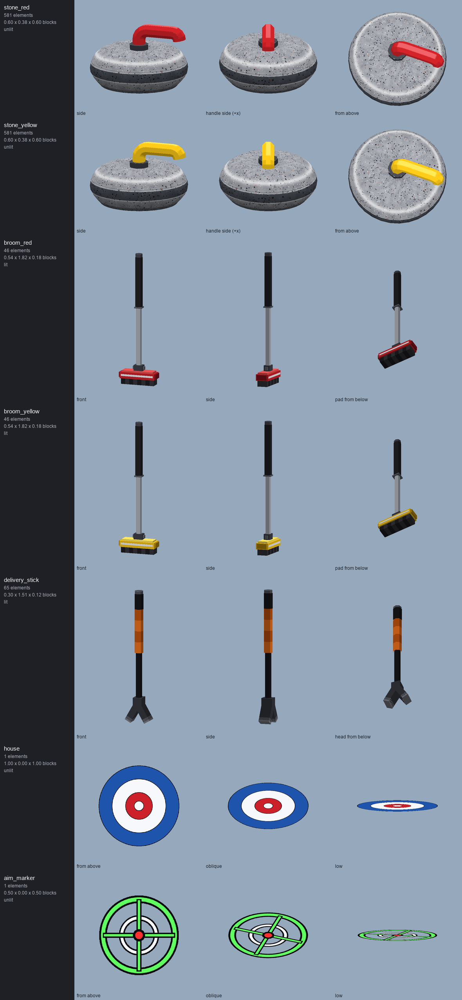

# Antigravity Server resource pack

Resource pack for the Antigravity Minecraft server (Minecraft Java 26.3).

## Pool and Billiards with round balls

`Pool-Resourcepack-v1.3.7-roundballs.zip` (see Releases) is the
[Pool and Billiards resource pack](https://modrinth.com/resourcepack/pool-and-billiards-resourcepack)
v1.3.7 by **YMS2001 / Squid Workshop**, with its 24 ball models replaced by real 3D spheres:

- each ball is 512 thin quads, each tangent to the sphere (Minecraft 26.x lets model elements
  rotate on all three axes), showing its patch of an equirectangular texture with the colour,
  stripe, number circles and cue-ball dots painted on in true sphere projection
- the datapack already rotates its balls as they roll, so the numbers and stripes roll with them
- Minecraft lights every item face by its nearest axis direction, which lights a sphere in six flat
  patches. The balls carry a tint colour no vanilla item uses (`#FEFDFC`), and the pack's patched
  `shaders/core/item.vsh` skips that lighting for exactly that tint.
- The shading is ray-traced: the server stacks one camera-facing square (`hg_ball_light`, tint
  `#FEFDFB`) at each ball's centre. The patched `item.vsh` works out the ball's centre from the
  square's corner (its vertex index within the quad) and the camera axes; the patched `item.fsh`
  intersects each pixel's line of sight with the sphere and draws the shading (a fixed light above the
  table, a darker rim and a gloss that follows the viewer) as a see-through layer, at the depth of the
  sphere's surface, so other balls and the cue cover it properly. `item.vsh`/`item.fsh` here are the
  26.3 originals the build patches; `McShaderCheck.java` compiles the patched pair the way the 26.3
  client does (shaderc to SPIR-V, Vulkan-style GLSL: `gl_VertexIndex`, not `gl_VertexID`) for every
  variant of the item pipelines. Run it before publishing: a shader that fails to compile makes the
  client drop the whole pack.


```
python build_sphere.py <original pack folder> <output folder>
python preview_sphere.py <output folder> preview_sphere.png   # checks quad placement, renders the preview
```

Earlier attempts, kept for reference: `build.py` (layered boxes), `build_sprites.py` (one camera-facing
picture; numbers always faced the viewer) and `build_rolling.py` (picture plus flat 3D markings).

## Curling

The `curling` namespace holds the curling set for the server's curling minigame: granite stones with
red and yellow handles (smooth bodies built from ~580 tangent quads, unlit with painted shading),
brooms, the delivery stick, the house rings decal and the aim marker. Generated by
`curling/build_assets.py`, previewed with `curling/preview_assets.py`.



The whole pack (pool table, 3D balls, curling) is built by `build_pack.py`, which also compiles the
patched shaders with the client's compiler settings before zipping.

## Licence and credit

The original pack is © YMS2001 / Squid Workshop under the
[Mozilla Public License 2.0](https://www.mozilla.org/en-US/MPL/2.0/); the modified files in this pack
are under the same licence. Original project:
https://github.com/MingshiYangUIUC/Pool-Minecraft-Squid-Workshop-Project
