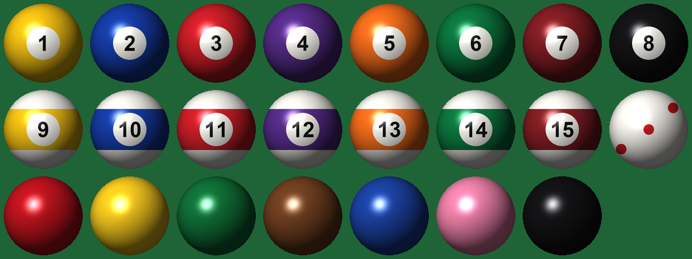

# Antigravity Server resource pack

Resource pack for the Antigravity Minecraft server (Minecraft Java 26.3).

## Pool and Billiards with round balls

`Pool-Resourcepack-v1.3.7-roundballs.zip` (see Releases) is the
[Pool and Billiards resource pack](https://modrinth.com/resourcepack/pool-and-billiards-resourcepack)
v1.3.7 by **YMS2001 / Squid Workshop**, with new ball models:

- every ball is a 128x128 picture of a shaded sphere (soft light, gloss highlight, stripe band,
  number circle) on a flat model; the server turns the ball entities to always face the viewer, so
  they look perfectly round from every angle
- real pool colours, a cue ball with red dots, plain snooker balls



Generated by `build_sprites.py` (current). `build.py` is the earlier layered-box version
(see `preview.png`), kept for reference.

```
python build_sprites.py <original pack folder> <output folder>
```

## Licence and credit

The original pack is © YMS2001 / Squid Workshop under the
[Mozilla Public License 2.0](https://www.mozilla.org/en-US/MPL/2.0/); the modified files in this pack
are under the same licence. Original project:
https://github.com/MingshiYangUIUC/Pool-Minecraft-Squid-Workshop-Project
