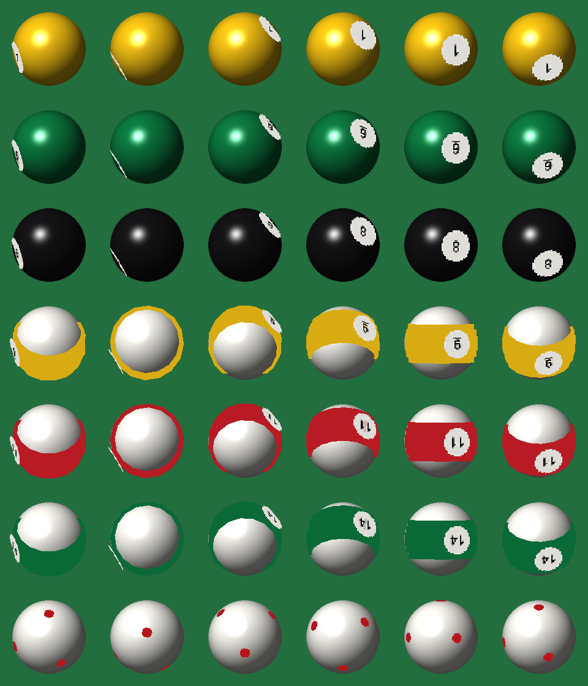

# Antigravity Server resource pack

Resource pack for the Antigravity Minecraft server (Minecraft Java 26.3).

## Pool and Billiards with round balls

`Pool-Resourcepack-v1.3.7-roundballs.zip` (see Releases) is the
[Pool and Billiards resource pack](https://modrinth.com/resourcepack/pool-and-billiards-resourcepack)
v1.3.7 by **YMS2001 / Squid Workshop**, with extra ball models. The pack's own ball models are
unchanged; the server draws each ball with two extra layers on top of the (hidden) original:

- **body**: a picture of a shaded sphere in the ball's colour that always faces the viewer, so the
  ball is perfectly round from every angle
- **marks**: the number circles, the stripe band and the cue ball's red dots as thin 3D pieces on the
  sphere's surface; the server gives them the ball's own rotation, so they roll with the ball and
  disappear round the back behind the body



Generated by `build_rolling.py`, previewed with `preview_rolling.py`:

```
python build_rolling.py <output folder>
python preview_rolling.py <output folder> preview_rolling.png
```

Earlier versions, kept for reference: `build.py` (layered boxes, `preview.png`) and the single
camera-facing picture with the numbers painted on (`build_sprites.py`, `preview_sprites.png`), whose
numbers always faced the viewer.

## Licence and credit

The original pack is © YMS2001 / Squid Workshop under the
[Mozilla Public License 2.0](https://www.mozilla.org/en-US/MPL/2.0/); the modified files in this pack
are under the same licence. Original project:
https://github.com/MingshiYangUIUC/Pool-Minecraft-Squid-Workshop-Project
