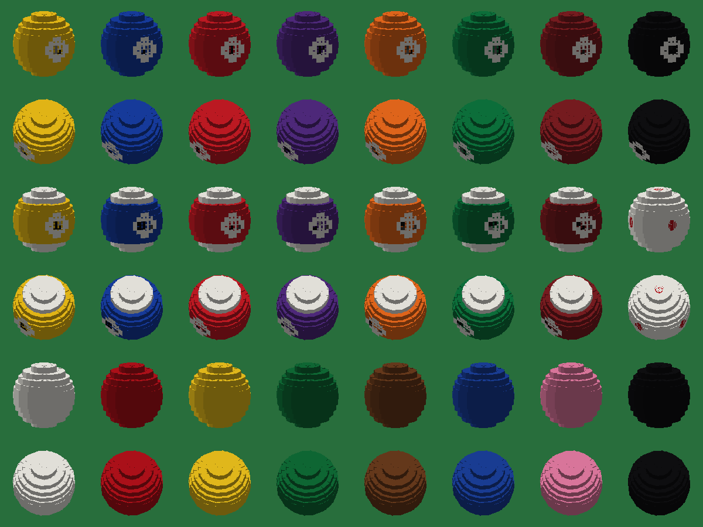

# Antigravity Server resource pack

Resource pack for the Antigravity Minecraft server (Minecraft Java 26.3).

## Pool and Billiards with round balls

`Pool-Resourcepack-v1.3.7-roundballs.zip` (see Releases) is the
[Pool and Billiards resource pack](https://modrinth.com/resourcepack/pool-and-billiards-resourcepack)
v1.3.7 by **YMS2001 / Squid Workshop**, with new ball models:

- every ball is built from layered 16-sided discs instead of square slices, so it looks round
- real pool colours, white caps on the stripe balls (9-15), number circles on two sides
- a cue ball with red dots so you can see spin, plain snooker balls



The new models and textures are generated by `build.py` (with `render.py` for previews):

```
python build.py <original pack folder> <output folder>
```

## Licence and credit

The original pack is © YMS2001 / Squid Workshop under the
[Mozilla Public License 2.0](https://www.mozilla.org/en-US/MPL/2.0/); the modified files in this pack
are under the same licence. Original project:
https://github.com/MingshiYangUIUC/Pool-Minecraft-Squid-Workshop-Project
