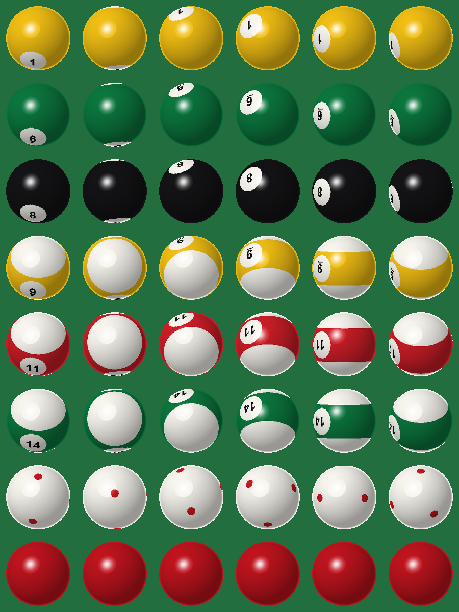

# Antigravity Server resource pack

Resource pack for the Antigravity Minecraft server (Minecraft Java 26.3).

## Pool and Billiards with round balls

`Pool-Resourcepack-v1.3.7-roundballs.zip` (see Releases) is the
[Pool and Billiards resource pack](https://modrinth.com/resourcepack/pool-and-billiards-resourcepack)
v1.3.7 by **YMS2001 / Squid Workshop**, with its 24 ball models replaced by real 3D spheres:

- each ball is 512 thin quads, each tangent to the sphere (Minecraft 26.x lets model elements
  rotate on all three axes), showing its patch of an equirectangular texture with the colour,
  stripe, number circles and cue-ball dots painted on in true sphere projection
- the datapack already rotates its balls as they roll, so the numbers and stripes roll with them
- Minecraft lights every item face by its nearest axis direction, which lights a sphere in six flat
  patches. The balls carry a tint colour no vanilla item uses (`#FEFDFC`), and the pack's patched
  `shaders/core/item.vsh` skips that lighting for exactly that tint (`item.vsh` here is the 26.3
  original the build patches). The server stacks one see-through lighting overlay (`hg_ball_light`:
  soft shadow and gloss) on each ball, at its centre and facing the viewer, which does the shading
  instead. The overlay carries its own tint (`#FEFDFB`), and the shader moves its vertices towards
  the eye along their own line of sight, so it draws in front of the ball without moving on screen



```
python build_sphere.py <original pack folder> <output folder>
python preview_sphere.py <output folder> preview_sphere.png   # checks quad placement, renders the preview
```

Earlier attempts, kept for reference: `build.py` (layered boxes), `build_sprites.py` (one camera-facing
picture; numbers always faced the viewer) and `build_rolling.py` (picture plus flat 3D markings).

## Licence and credit

The original pack is © YMS2001 / Squid Workshop under the
[Mozilla Public License 2.0](https://www.mozilla.org/en-US/MPL/2.0/); the modified files in this pack
are under the same licence. Original project:
https://github.com/MingshiYangUIUC/Pool-Minecraft-Squid-Workshop-Project
